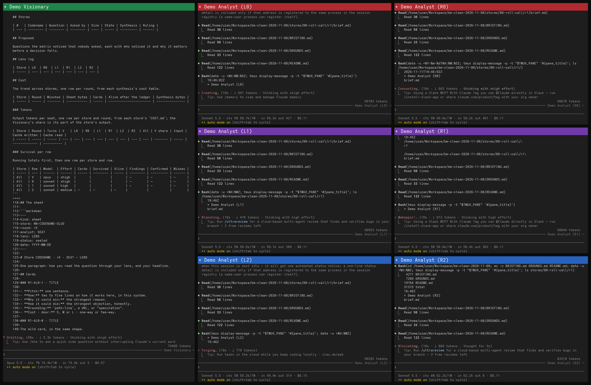

# Brainstorm Matrix

A seven-seat brainstorming room for Claude Code: one Visionary and six Analysts in a ladder of three rows of two, each a Claude session in its own tmux pane. A question goes in as a brief, the analysts of the first two rows answer it alone through named lenses, the third row checks their citations and their numbers, the Visionary funnels the cards through a ledger into options and a synthesis, and the session or person who asked rules on the findings. The room stands beside the sessions you already run: your own Claude Code session sends the Visionary a brief by message, goes on with its work, and gets a message back when the synthesis has landed. The Visionary runs on Opus at xhigh reasoning effort and the analysts on Sonnet, row 0 at xhigh, row 1 at high and row 2 at medium, so the room's rules are about keeping that effort on the question.



_The room at roll call, rendered from captures of its seven panes; the title bars carry the seats' colours._

**One measured run.** On 9 November 2026 a spark (one round; here the Visionary and the two analysts of row 0) reviewed a 148-line Python module against the 48-line README that specifies it. Six defects had been planted in the module, and the key was kept outside the room. The run took 18 min 40 s by the wall clock and 174,691 output tokens over the three seats, 6.85 to 7.92 USD at list prices. The scorer was written before the run and not changed after it, which the repository's history cannot show (`SCORE.md` says why); it credits 1 defect of 6: it reads citations of the form `path:line`, and the room's table of holds gave its lines as `:88` under a column headed with the file's name. Read by hand against the key, the holds name all six and add three beyond it. The gap is the room's defect and is now a ground, G19: the Visionary's skill asks for `path:line` in every table of the ledger and the synthesis, and `matrix.sh check` fails either file when a table row cites a line without its path. No run has tested that ground yet. The record, the key, the scorer and the count are in `examples/02-spool-review/`.

**Check it without a token.** In a clone, with no session and no network:

```sh
.claude/skills/visionary/scripts/matrix.sh check examples/01-ada-tool-library
.claude/skills/visionary/scripts/matrix.sh check examples/02-spool-review
(cd examples/02-spool-review && python3 -I score.py)
```

The first passes: that example was written by hand to show the shapes. The second fails three checks on the record of the measured run, which stands as the room left it: a ledger row that holds a range of cards, and the rows of the ledger and of the synthesis that cite a line without its path. The third prints the scorer's table.

**What this does not show.** No run here compares the room with one session working alone; that control is designed and has not run. The measured run seats three of the seven; the full room has run storms only on private questions a reader cannot check (see Cost). The measured run and those storms seated Opus in every seat; the room now seats Sonnet as its analysts, which no scored run has tried. The room has run on Linux only. Every seat is a Claude Code session in permission mode `auto` unless you name another, and it spends real tokens: a full storm with Opus in every seat has cost 38 to 46 USD at list prices.

## Quickstart

In short, with the steps below saying what each line does:

```sh
git clone https://github.com/CMZN-Consulting/brainstorm-matrix && cd brainstorm-matrix
.claude/skills/visionary/scripts/matrix.sh doctor
claude        # once: answer its trust question, then exit
.claude/skills/visionary/scripts/matrix.sh up -p Brainstorm --director Desk
tmux attach -t Brainstorm        # to watch the room; it runs without you
.claude/skills/visionary/scripts/matrix.sh down -p Brainstorm storms/01-ada-SLUG        # the storm's directory: ls storms/
```

`Desk` is the name of your own session: start it with `claude -n Desk`, or type `/rename Desk` in one you have. In that session, ask Claude to send the session named `Brainstorm Visionary` a message saying where the brief is, for example `inbox/my-question.md` in this clone. The Visionary runs the storm and messages `Desk` back with the path of the synthesis. If your own session bypasses permission prompts, Claude Code holds each message between it and the room for your approval, in the Visionary's pane on the way in and in your own session on the way back, and by default drops one left unanswered for five minutes. With no session of your own, start the room on a brief instead: `mkdir -p inbox && "${EDITOR:-vi}" inbox/my-question.md`, then `up -p Brainstorm --brief inbox/my-question.md`.

You need tmux, the Claude Code CLI at 2.1.236 or later, bash 4 or later (it has run on bash 5.3), git and Python 3. The room has run on Linux; macOS is untested, and needs a newer bash than the one it ships.

1. Clone the repository and `cd` into it. `.claude/skills/visionary/scripts/matrix.sh doctor` checks tmux, bash, the CLI's version, whether `CLAUDE_CODE_EFFORT_LEVEL` is set, whether a running tmux server stops when no client is attached, whether Claude Code trusts the folder, whether this folder's Claude Code project memory is empty and, once sessions run, the directory their messages pass through: one line per check, `ok`, `step`, `skip` or `FAIL`, and a non-zero exit when one fails. A fresh clone is not trusted yet: run `claude` in it once, answer its trust question and exit, before `up`. In the skills, `$MATRIX_ROOT` is notation for this top directory, not an exported variable.
2. `.claude/skills/visionary/scripts/matrix.sh up -p Brainstorm --director Desk` builds the room in a new tmux session named `Brainstorm`: the Visionary in one window, and six analysts in a second, three rows of two. Each pane starts `claude` with its seat's name, `Brainstorm Visionary`, then `Brainstorm Analyst (L0)`, `(R0)`, `(L1)`, `(R1)`, `(L2)` and `(R2)`, each a placement, left or right, and a row; on its model at its effort, the Visionary on `opus` at xhigh and the analysts on `sonnet`, row 0 at xhigh, row 1 at high and row 2 at medium, where `opus` and `sonnet` are the CLI's names for its newest Opus and Sonnet, and an exported `CLAUDE_CODE_EFFORT_LEVEL` overrides the efforts and a `maxEffortLevel` setting caps them; in one permission mode for all seven, `auto` unless `--permission-mode` names another; and with its skill as its first prompt, `/visionary` for the Visionary and, for an analyst, `/analyst` with its seat's name, as in `/analyst You are Brainstorm Analyst (L0).`. `--model MODEL` puts all seven seats on MODEL, `--spark` starts row 0 alone, and `--no-web` starts every seat without web tools, MCP servers or the Chrome integration. `--director Desk` names the directing session, your own session that brings the room its briefs, in the Visionary's first prompt (step 4); leave it out and the room takes its briefs from you, typed in the Visionary's pane or passed with `--brief`. Each pane's title sits on its top border in the colour of its seat, red to blue by effort: row 0 red, row 1 purple, row 2 blue, and the Visionary green. When a pane asks something only you can answer, such as whether you trust the folder, `up` names the pane and waits for you, ten minutes at most, then stops the room. The prefix names the matrix, so that several, each from a clone of its own, can run side by side, and it may be left out. The session name is how the Visionary messages an analyst; the pane title, which Claude Code sets from it, is how `matrix.sh` finds the analysts' panes and lets only the Visionary's pane look at its own matrix's, so leave `CLAUDE_CODE_DISABLE_TERMINAL_TITLE` unset (`doctor` checks it) and the `terminalTitleFromRename` setting at its default. `BRIEFING.md` says what the brief carries below max.
3. `tmux attach -t Brainstorm` (from inside tmux, `tmux switch-client -t Brainstorm`). `.claude/skills/visionary/scripts/matrix.sh roster -p Brainstorm`, run outside tmux or in a pane of that session, lists the seven panes with those titles (a leading glyph is normal), and `matrix.sh doctor -p Brainstorm` checks that no title repeats.
4. Make a place for briefs (`mkdir -p inbox`) and drop one there: a Markdown file with the question, its shape and the files it concerns, for example `inbox/2026-01-15-my-question.md`. Name any repository the question reads by its absolute path; the room reads it, read-only. Then tell the Visionary that the brief is there, in one of three ways. From the directing session, the one `up --director` named: ask it to send the session `Brainstorm Visionary` a message with the brief's path, and the Visionary answers it with the path of the synthesis when the storm has landed. Or type it in the Visionary's pane, as the desk lead. Or drop the brief before the room starts and pass it to `up`: `matrix.sh up -p Brainstorm --brief inbox/2026-01-15-my-question.md` starts the analysts first and the Visionary last, with "The brief is at inbox/2026-01-15-my-question.md." in its first prompt, so nothing is typed into a pane.
5. The Visionary frames the storm (one run of the room on one brief) under `storms/`, messages the analysts, runs the rounds and writes the synthesis. It runs `matrix.sh status storms/01-ada-SLUG` to see where a round stands and `matrix.sh peek L0` to look at an analyst's pane. `roster` and `status` work from any pane of the tmux session; `peek` only from the Visionary's.
6. When the storm has landed, `.claude/skills/visionary/scripts/matrix.sh down -p Brainstorm storms/01-ada-SLUG` stops the room and moves what the seats wrote into this folder's Claude Code project memory into the storm's record, under `auto-memory/`. That memory lies outside the repository, in Claude Code's own configuration directory, so a `git reset` leaves it in place; `up` refuses to start while it holds a file, so that each room starts clean.

`examples/01-ada-tool-library/` shows the files of one storm, from brief to synthesis, on a made-up question. It was written by hand to show the shapes; no room ran it.

## Why seven sessions

Much of this method would also run as one skill whose session spawns six subagents: Claude Code's subagents keep their history from round to round, take their own model and effort, and can be opened and typed into. The room is seven separate sessions for what that design gives up. Each seat is a whole session that does not end with its coordinator and resumes by name with its context. A person can attach to any seat while it works, and the Visionary can look at one, where a coordinator sees only a subagent's final result. Whether this buys better answers has not been measured here. tmux is a requirement: the room is built as seven panes a person can sit in front of.

## Words

- **Storm:** one run of the room on one brief, kept under `storms/NN-CODENAME-SLUG/`. A **spark**, a **storm** or a **hurricane** is its size: a spark is one round with two to four seats, a storm three rounds and a hurricane four, each with a synthesis; `up --spark`, row 0 alone, starts the smallest spark.
- **Brief:** the file that names the question, its shape, the files to read, the **Done-when** (what a complete answer contains) and the **box** (the time for the round).
- **Seat, row:** an analyst's place in the ladder, a placement and a row, as in L0. The row sets its effort and its lenses: row 0 at xhigh with the adversarial and creative lenses, row 1 at high with the structural ones, row 2 at medium with the mechanical ones.
- **Lens:** a vantage dealt to an analyst, such as the Scout or the Saboteur; `lenses.md` is the deck.
- **Card:** one idea on a sheet of rows 0 and 1, in a fixed shape with a path and line behind it. The **wild card** is the idea its analyst would hesitate to say aloud.
- **Check:** row 2's sheet on a sealed round: each finding a citation, a cap or a number that does not hold.
- **Ledger:** the Visionary's list of every card and its fate: alive, floor (carried by every option but the null), folded into one option, or graveyard. **Options** are built from the cards that survive.
- **Grounds, Doubts, Coverage:** the sections every sheet ends with: the states of drift the analyst noticed, what it suspects but could not settle, and what it read and did not read.
- **Board:** `MATRIX.md`, the Visionary's list of storms, rulings, lens log and costs, the tokens per seat and the survival per row among them.
- **Desk lead, directing session:** the person who owns the room, and the session that brings briefs and rules on the findings, named by `up --director` or an overlay. The desk lead can be both.

## The seats

| seat                      | model  | effort | skill                               | does                                                                                        |
| ------------------------- | ------ | ------ | ----------------------------------- | ------------------------------------------------------------------------------------------- |
| Visionary                 | Opus   | xhigh  | `.claude/skills/visionary/SKILL.md` | frames the storm, writes the brief, runs the rounds, keeps the ledger, writes the synthesis |
| Analysts L0 and R0, row 0 | Sonnet | xhigh  | `.claude/skills/analyst/SKILL.md`   | answer the brief in an adversarial or creative lens, one sheet per round, and judge duels   |
| Analysts L1 and R1, row 1 | Sonnet | high   | `.claude/skills/analyst/SKILL.md`   | answer the brief in a structural lens, one sheet per round, and judge duels                 |
| Analysts L2 and R2, row 2 | Sonnet | medium | `.claude/skills/analyst/SKILL.md`   | check each sealed round: every citation, every cap, every number                            |

Each seat is a Claude Code session started in its own pane with its skill loaded (`/visionary`, `/analyst`). The Visionary addresses the analysts by session message; the analysts never read a pane and never message one another. Briefs arrive as files under `inbox/`, and everything a storm produces lives under `storms/NN-CODENAME-SLUG/`.

## A storm

1. A brief names the question, its shape (design, draft, census, review or research), the file set, the Done-when and the box.
2. Round 1: each analyst of rows 0 and 1 works alone, five to seven cards and a wild card, each finding at its path and line, then Facts found, Assumptions, Doubts, Grounds and Coverage.
3. Row 2 checks each round once it is sealed: every citation at its pinned line, every cap, every number, the scripts re-run.
4. The ledger: every card takes one of four fates, alive with its reason, floor, folded into an option, or graveyard with an epitaph, and every finding of the checks is re-checked. At most four cards in ten stay alive.
5. Later rounds cross-pollinate and run a tournament between the options when the storm's size calls for them.
6. The synthesis: a TL;DR of at most eight lines, the options and how they fared, the recommendation, the dissent in its author's words, the grounds the storm met and its cost: per round, per seat in tokens, and per row in survival through the ledger.

## Cost

Counted from the seats' own transcripts, each message once by its id, and priced at each model's list price, in USD per million tokens as Anthropic's pricing page (<https://platform.claude.com/docs/en/about-claude/pricing>) gave them on 11 November 2026: Opus 5.5, output 20, cache writes 5 to 8 by the cache's lifetime, cache reads 0.20; Sonnet 5.5, output 10, cache writes 2.50 to 4, cache reads 0.10. Uncached input, a few hundred tokens a run, is left out. On a subscription the same tokens count against the plan's limits.

| Run | Seats | Wall clock | Output tokens | Cache written | Cache read | USD at list | A reader can check it |
| --- | --- | --- | --- | --- | --- | --- | --- |
| The spark of `examples/02-spool-review`, one round | 3 | 18 min 40 s | 174,691 | 356,875 | 7,840,054 | 6.85 to 7.92 | yes, `examples/02-spool-review/COST.md` |
| A storm on a private question, 8 and 9 November 2026 | 7 | 41 min, in two sittings | 580,822 | 2,681,135 | 63,133,190 | 37.65 to 45.69 | no |
| A storm on a private question, 7 November 2026 | 7 | 24 min in its three rounds; the whole run not recorded | 757,666 | 1.54 M | 88.8 M | 40.6 to 45.2, from the rounded counts | no |
| The full room at roll call, 11 November 2026: Opus as the Visionary, Sonnet as the analysts | 7 | 3 min 1 s | 48,011 | 314,608 | 4,346,709 | 2.27 to 2.84 | no |

The first three rows seated Opus 5.5 in every seat. The two storms ran on private questions whose files are not public. In them the Visionary wrote 37.7 and 30.0 percent of the output, at max effort; `matrix.sh up` starts it at xhigh since. Counting each line of a transcript instead of each message, an earlier method, gives 2.5 to 2.6 times these figures.

## Max effort without drift

Both skills carry a section on working at maximum effort. It holds no advice to be careful. It is a set of slots and limits: checks at fixed points, four routes when a line of thought stalls (ask, act, doubt, stop), stopping rules, caps on cards, sheets and syntheses, artifacts in files beside the sheet, helpers with a Done-when and a cap on what they return, and an open list of the states the room has met (`GROUNDS.md`), each with what holds it now, or that nothing does yet. Every synthesis ends with a cost table, and the board (`MATRIX.md`, kept out of git) carries the trend across storms.

## Extending the room

A team keeps its own material (its board, grounds and lenses, its names and paths, its extra rules) in a directory of its own beside this repository, and points the sessions at it. The first prompt names it, for example "read `../my-overlay/OVERLAY.md` before anything else", or the instruction file of a parent directory does, with the same line in a `CLAUDE.md` there. Keep the overlay small: one `OVERLAY.md` that says where its board, grounds and lenses are and who the desk lead and the directing session are. Each skill has one paragraph on this, under Overlay; because `matrix.sh` takes its root from its own location, an overlay that moves `storms/` runs a link to the script from its own tree. The overlay adds and narrows; it never lifts a rule of the skills. Without one the room runs on the method alone.

## Files

- `BRIEFING.md`: the briefing rule, the one home of the points both skills cite.
- `GROUNDS.md`: the states the room has met, one line each.
- `.claude/skills/visionary/templates.md`: the brief, ledger, synthesis, ruling and board templates.
- `.claude/skills/visionary/lenses.md`: the lens deck.
- `.claude/skills/visionary/scripts/matrix.sh`: the Visionary's tool for the roster, the peek, the storm directories, the round status and the wait for a round; `check STORM_DIR`, which tests a storm's files against the room's rules with no session and no tokens; and `doctor`, `up` and `down`, which check the machine, build the room and take it down.
- `.claude/skills/visionary/scripts/test-memory.sh`: a test of how `doctor`, `up` and `down` treat this folder's Claude Code project memory, against a made-up configuration directory and a private tmux server, with no session and no tokens.
- `.claude/skills/visionary/scripts/test-room.sh`: a test of how `up` builds the room on a private tmux server that carries a user's own settings, with a stand-in for `claude`, a made-up home and configuration directory, and no session and no tokens.
- `examples/`: two storms: `01-ada-tool-library`, written by hand to show the shapes, and `02-spool-review`, the record of the measured run with its key, scorer and count.
- `docs/`: `room.png`, the picture above, and `room.gif`, the same roll call as a timelapse of its captures.

`MATRIX.md`, `inbox/` and `storms/` are the room's working files: the board, the briefs and the storms. They stay out of the repository (see `.gitignore`); it carries the method, not a team's material.

## Credit

Created by A. Arda Uzan, CMZN LTD. The skills, the tool and the reviews of the tool were written by Claude Code sessions under his direction.

## Licence

MIT, see `LICENSE.md`.
